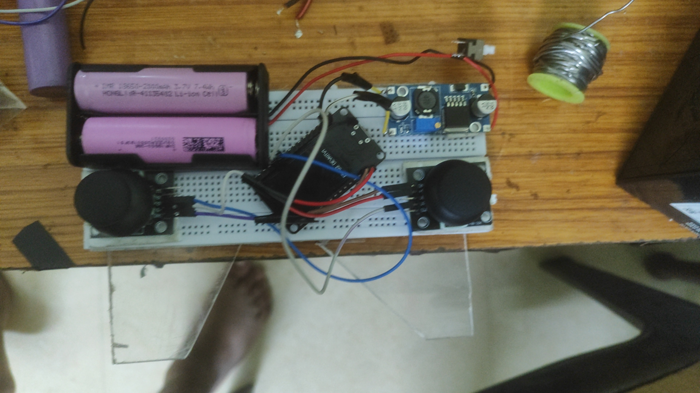
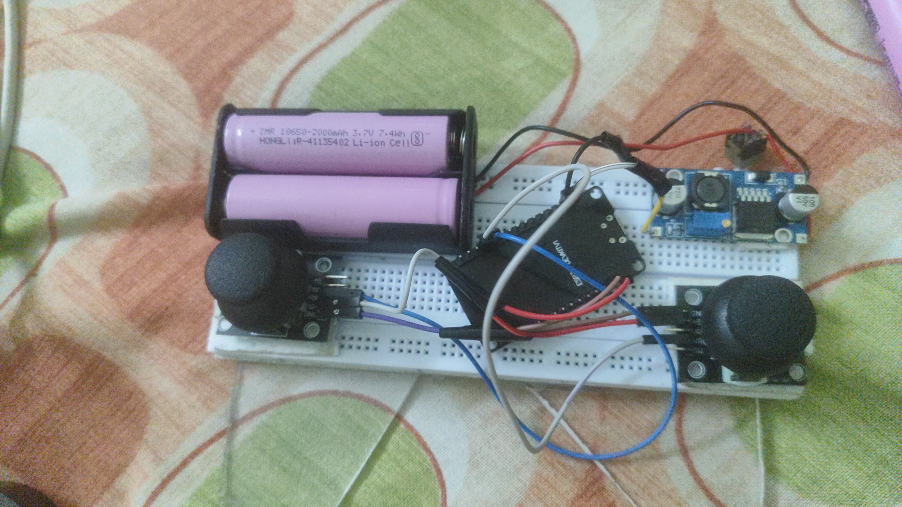

# Low-Latency ESP-NOW Wireless Telemetry: Connectionless Peer-to-Peer Protocol with Dynamic Joystick Calibration


[](https://github.com/ParthDalakoti/esp32-espnow-bidirectional-telemetry/actions) [](https://wokwi.com)

[](https://www.espressif.com/)
[-000000.svg?style=for-the-badge)](https://www.espressif.com/)
[]()
[]()
[](https://opensource.org/licenses/MIT)

> **Wireless Embedded Communications Project | Graphic Era Hill University (B.Tech ECE 2023–2027)**  
> **Author:** Parth Dalakoti (*President, Robotics & Automation Club, GEHU*)  
> **Contact:** `parthdalakoti482@gmail.com` | [LinkedIn](https://linkedin.com/in/parthdalakoti)

---

## ⚡ Executive Summary

This repository implements a **sub-5ms Latency Wireless Telemetry Link** between two **ESP32** microcontrollers utilizing Espressif's proprietary **ESP-NOW connectionless protocol**:
1. **Routerless Direct-MAC Link:** Transmits encrypted binary data packets directly across 2.4 GHz radio channels without Wi-Fi handshakes, routers, or IP stack overhead.
2. **Dynamic Joystick Deadzone Calibration:** Features auto-learning analog midpoint centering and min/max calibration on the transmitter node to eliminate potentiometer drift.
3. **Structured Binary Framing:** Packs multiple telemetry streams (steering, throttle, switch states) into compact C structs with hardware CRC validation.

---

## ⚙️ Architecture & Packet Protocol

```mermaid
graph LR
    subgraph Transmitter_ESP32 [Transmitter Node]
        JoyX[Joystick X - Pin 35] -->|12-bit ADC| Cal[Deadzone Auto-Calibration]
        JoyY[Joystick Y - Pin 34] -->|12-bit ADC| Cal
        Cal -->|Binary Struct Packet| ESP_Tx[ESP-NOW Master Controller]
    end

    ESP_Tx -.->|2.4 GHz Direct MAC Frame (<5ms)| ESP_Rx[ESP-NOW Receiver Node]

    subgraph Receiver_ESP32 [Receiver Node]
        ESP_Rx -->|esp_now_register_recv_cb| Callback[OnDataRecv ISR Callback]
        Callback -->|Parsed Throttle / Steer| MotorLogic[Differential Drive PWM]
        MotorLogic --> MotorA[Left Motor Controller]
        MotorLogic --> MotorB[Right Motor Controller]
    end
```

---

## 🛠️ Bill of Materials (BOM)

| Component | Model / Spec | Operating Voltage | Interface | Function |
| :--- | :--- | :--- | :--- | :--- |
| **Microcontroller (x2)** | ESP32-WROOM-32 (Dual Core 240MHz) | 3.3V / 5V USB | ESP-NOW 2.4GHz | Transmitter and receiver radio nodes |
| **Analog Joystick** | 2-Axis Potentiometer + Pushbutton | 3.3V | Dual Analog ADC (Pins 34, 35) | Throttle & steering control inputs |
| **Motor Driver** | Dual H-Bridge Motor Driver | 5V - 12V | PWM Pins 18, 19, 21, 22 | Actuation driven by receiver node |

---

## 🔌 Hardware Pinout Mapping

### Transmitter Node
* **Throttle (Y-Axis):** `GPIO 34` (ADC1 Channel 6)
* **Steering (X-Axis):** `GPIO 35` (ADC1 Channel 7)
* **Status LED:** `GPIO 2`

### Receiver Node
* **Motor Left PWM:** `GPIO 18 / 19`
* **Motor Right PWM:** `GPIO 21 / 22`
* **Payload Indicator:** `GPIO 2`

---

## 🚀 How to Setup MAC Addressing

1. Find your receiver ESP32 MAC address:
   ```cpp
   Serial.println(WiFi.macAddress());
   ```
2. In [`firmware/Transmitter/Transmitter.ino`](firmware/Transmitter/Transmitter.ino), configure:
   ```cpp
   uint8_t receiverMAC[] = {0x70, 0x4B, 0xCA, 0x6E, 0x4D, 0xCC};
   ```
3. Flash Transmitter and Receiver sketches to respective ESP32 boards.

---

## 👨‍💻 Engineering Author
**Parth Dalakoti**  
*B.Tech in Electronics & Communication Engineering (2023–2027)*  
*Graphic Era Hill University (GEHU), Bhimtal Campus*  
*President, Robotics & Automation Club, GEHU*

---

## 📸 Hardware Bench Test Photos





